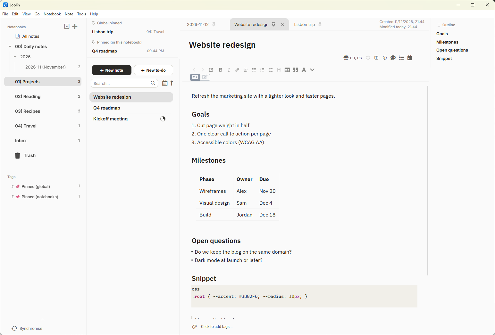
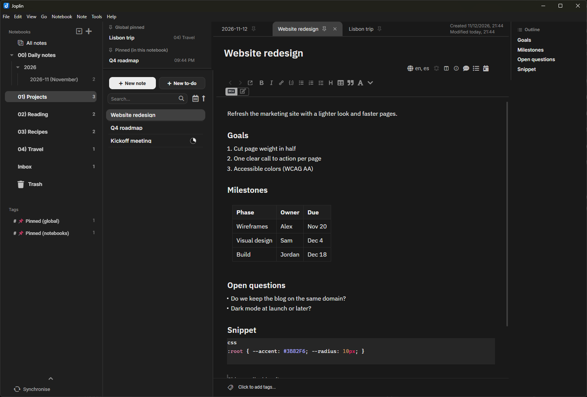

# Modern Joplin

Two plugins for Joplin desktop (3.0 or later).

| Light | Dark |
|---|---|
|  |  |

> **Note:** these screenshots were taken before Theme 3.5.1. In the compact note list, the bottom of letters like *g*, *p* and *y* is clipped (see "Q4 roadmap" or "Kickoff meeting"). This is fixed in the latest release; the screenshots haven't been updated yet.

| Folder | Plugin | What it does |
|---|---|---|
| `features/` | **Modern Joplin - Features** (`local.modernjoplin.features`) | Tabs, pinned notes (per notebook and global, also mirrored as tags for mobile), today's and yesterday's daily notes (Ctrl+Alt+D / Ctrl+Alt+Y), note outline, an Aa paragraph-style button, a customizable editor toolbar, and remembering your position in each note. |
| `theme/` | **Modern Joplin - Theme** (`local.modernnotes.joplin`) | Light/dark theme with refined typography and a sidebar with clear hierarchy. |

The plugins' UI is available in English and Spanish (it follows Joplin's language).

## Download

Get the two `.jpl` files from the [latest release](../../releases/latest).

## Build

No Node or dependencies needed: a `.jpl` file is just a `.tar` of the plugin's files.

- Windows: `.\build.ps1`
- Linux/macOS: `./build.sh`

Packages are written to `dist/`. To publish a release, run the *Release* workflow from the Actions tab (or push a tag like `v2026.11.12`).

## Install or update

1. Joplin › Tools › Options › Plugins › ⚙ › *Install from file* and pick the `.jpl` from `dist/`
   (or copy it into the `plugins` folder of your Joplin profile).
2. Bump `version` in `manifest.json` on every change so Joplin reloads it.
3. Restart Joplin.

## Licenses

MIT (see each plugin's `LICENSE`). Lucide icons (ISC) and the Inter, IBM Plex Sans and Source Serif 4 fonts (OFL) are in `*/licenses/`.
